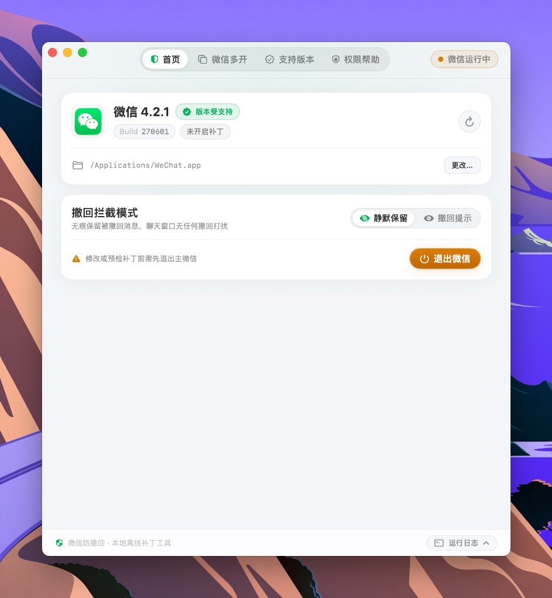
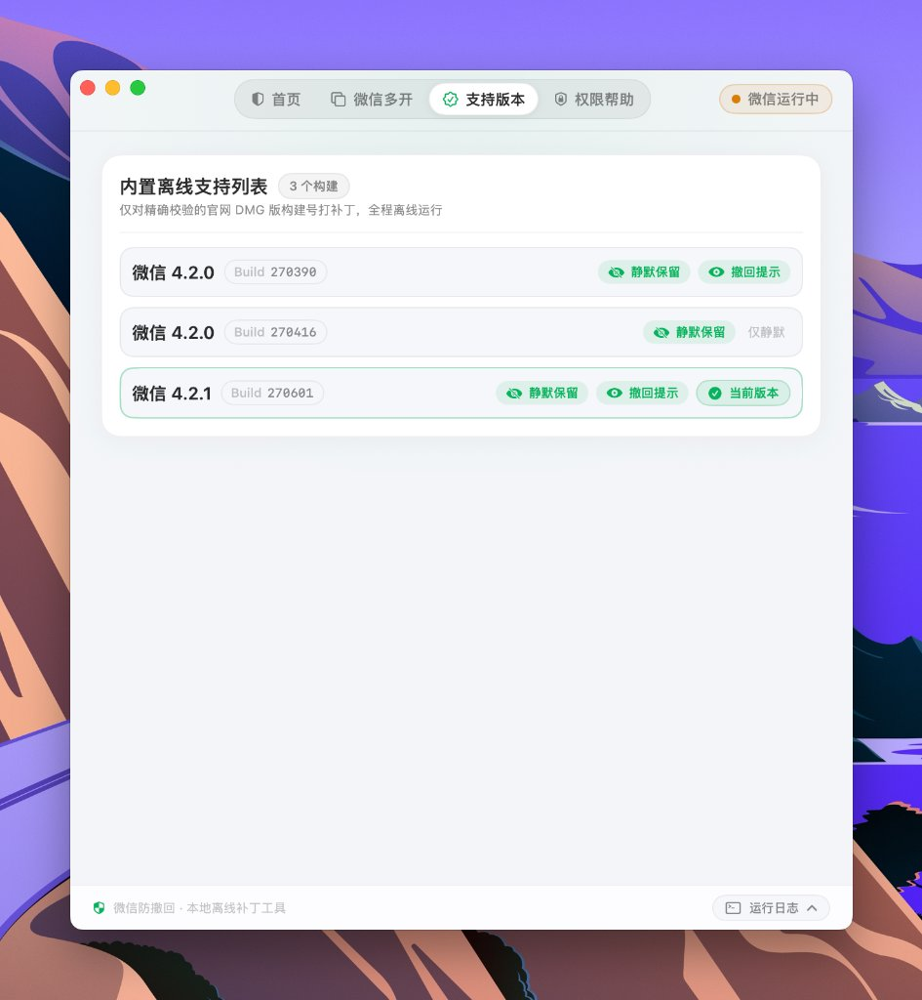
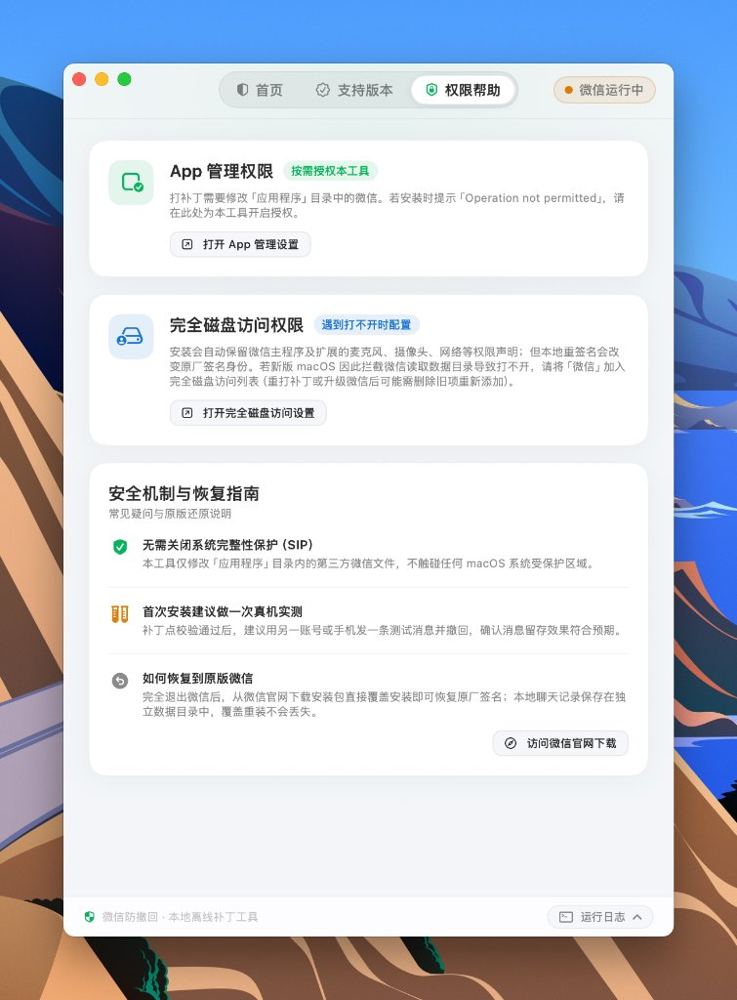

# AntiRecall（微信防撤回 & 多开）

一款轻量、纯离线的 macOS 微信防撤回与多开分身管理工具，专注做好两件事：**让别人撤回的消息原样保留**，以及**安全创建独立微信多开分身**。

| 首页 | 支持版本 | 权限帮助 |
| :---: | :---: | :---: |
|  |  |  |

## 特性

- **纯字节补丁**：直接修补目标指令，无需注入 `dylib`、无需常驻后台进程、无需关闭 SIP。
- **双模式切换**：
  - **静默保留**（默认）：消息无痕留下，界面无任何提示。
  - **显示撤回提示**：保留原消息的同时，显示微信原生「撤回了一条消息」提示。
- **独立微信多开**：
  - 一键生成独立 Bundle ID 的多开应用包（`微信 2`、`微信 3`…），无需退出正在运行的主微信即可创建，支持多账号同时在线且聊天数据彼此独立。
  - 同步改写中文/英文 `InfoPlist.strings`，使 Finder、Dock 与菜单栏原生显示「微信 2」等独立名称，并默认剥离 `weixin://` URL Scheme 防止链接误唤起。
  - 创建或同步重建分身时可按需一并写入静默/提示防撤回补丁；未适配补丁的新版微信仍可正常创建纯净多开分身。
- **安全离线校验**：内置精确的离线补丁表，不联网拉取未知数据；安装前自动 `dry-run` 预检并备份原文件，重签名后逐项校验 entitlements。
- **原生 SwiftUI 界面**：紧凑单栏设计，自适应 macOS 亮/暗双色外观，内置运行日志抽屉。

## 支持环境

- **系统要求**：Apple Silicon（M 系列）Mac，macOS 12+（暂不支持 Intel Mac）
- **微信渠道**：仅支持**微信官网 DMG 版**（不支持 Mac App Store 版）

| 微信版本 | 构建号（Build） | 静默保留 | 显示撤回提示 |
| --- | --- | :---: | :---: |
| 4.2.0.54 | `270390` | ✅ | ✅ |
| 4.2.0 | `270416` | ✅ | — |
| 4.2.1 | `270601` | ✅ | ✅ |

## 快速开始

1. 从 [Releases](../../releases) 下载最新 `.dmg`（或自行从源码构建），将 `AntiRecall.app` 拖入「应用程序」。
2. **首次打开**：右键点击 `AntiRecall.app` →「打开」以通过 Gatekeeper 提示。
3. **完全退出微信**，打开 `AntiRecall`，确认检测到受支持版本后选择拦截模式并点击开启。
4. 重新打开微信，建议用另一账号发送并撤回一条测试消息以验证效果。
5. 如需多开，可切换至「**微信多开**」标签页一键新建独立分身（无需退出主微信）。

> [!NOTE]
> 如安装后遇到写入受阻或微信无法打开，请参考应用内「**权限帮助**」页面授予对应权限（**App 管理** / **完全磁盘访问**）。如需恢复原版微信，完全退出后从[微信官网](https://weixin.qq.com)下载安装包覆盖重装即可（本地聊天记录不会丢失）。

## 从源码构建

需要 macOS 15 / Xcode 16+（Swift 6）：

```bash
# 运行单元测试
swift test

# 打包生成 dist/AntiRecall.app
bash Scripts/make-app.sh
open dist/AntiRecall.app
```

## 命令行（CLI）

工具核心与 GUI 解耦，也可直接使用命令行：

```bash
swift build -c release --product wx-antirecall
WXAR_CLI="$(swift build -c release --show-bin-path)/wx-antirecall"

# 查看当前微信版本与支持状态
"$WXAR_CLI" versions --app /Applications/WeChat.app --config ./patches.json

# 仅检查补丁点（不修改文件）
"$WXAR_CLI" install --dry-run --app /Applications/WeChat.app --config ./patches.json

# 安装防撤回（加入 --with-tip 可启用撤回提示模式）
"$WXAR_CLI" install --app /Applications/WeChat.app --config ./patches.json

# 从备份还原
"$WXAR_CLI" restore --app /Applications/WeChat.app \
  --binary Contents/Resources/wechat.dylib \
  --backup /Applications/WeChat.app/Contents/Resources/wechat.dylib.wx-antirecall-backup-YYYYMMDD-HHMMSS

# 查看已创建的微信多开分身及补丁状态
"$WXAR_CLI" clone list --output-dir /Applications --config ./patches.json

# 创建多开分身（默认从序号 2 递增分配，可选 --patch-mode none|silent|with-tip，加 --replace 可覆盖重建）
"$WXAR_CLI" clone create --app /Applications/WeChat.app --output-dir /Applications --patch-mode silent --config ./patches.json

# 删除由本工具创建的多开分身（不会删除本地聊天数据）
"$WXAR_CLI" clone remove --target "/Applications/WeChat 2.app"
```

更多底层补丁原理与适配记录见 [MAINTAINING.md](MAINTAINING.md)。

## 免责声明

- 本项目仅供个人学习 macOS Mach-O 二进制结构与签名机制的技术研究使用，**严禁用于任何商业用途或违反法律法规的场景**。
- 本项目为独立第三方开源工具，与腾讯公司及微信官方没有任何关联。
- 修改客户端二进制文件可能违反目标软件的用户服务协议；使用本工具所产生的任何后果（包括但不限于程序异常、账号限制等）均由使用者本人自行承担，开发者不承担任何直接或间接责任。

## 开源协议

基于 [MIT License](LICENSE) 开源。参考项目：[fzlzjerry/wechat-antirecall](https://github.com/fzlzjerry/wechat-antirecall)。
